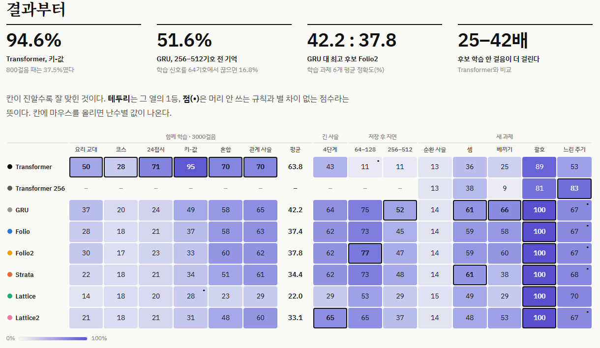
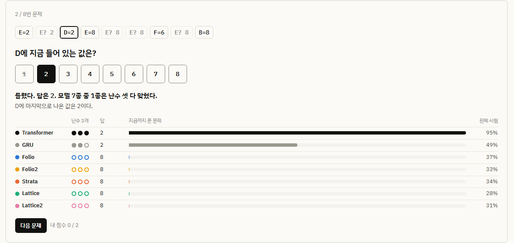

# 기록장, 지층, 격자

> [!WARNING]
> **아직 미완성이다.** 세 후보 모두 GRU를 못 넘었고, 학습률도 모델별로 찾아보지 않았다. 바로 쓸 수 있는 모델이나 학습된 가중치는 없다. 아래 결과는 결론이 아니라 중간 기록이다.

트랜스포머 말고 다른 구조로 다음 기호를 맞힐 수 있을까? 구조 세 개를 만들어서 비슷한 크기(약 10만 파라미터)의 Transformer, GRU와 같은 조건으로 붙여 봤다.

### **[결과 페이지 열기 →](https://monitari.github.io/folio-strata-lattice/)**

그래프를 만져 볼 수 있고, 모델이 받은 시험 문제를 직접 풀어 볼 수도 있다.

[](https://monitari.github.io/folio-strata-lattice/#board)

칸이 진할수록 잘 맞힌 것이고, 테두리는 그 열의 1등이다. 난수 3개 평균이다.

## 세 후보

| | 원리 | 노린 것 |
|---|---|---|
| **Folio** (기록장) | 기억 칸 32개에 적고 주소로 꺼낸다 | 정확히 적었다 꺼내기 |
| **Strata** (지층) | 네 층이 1 · 4 · 16 · 64 기호마다 고쳐진다 | 빠른 변화와 느린 흐름이 섞인 신호 |
| **Lattice** (격자) | 칸 16개가 이웃과 세 번 말을 주고받는다 | 여러 번 따라가는 계산 |

개선판 Folio2, Lattice2도 같은 조건으로 돌렸다. 이름은 작업명이고, 학술적으로 새롭다고 주장하는 건 아니다.

## 직접 풀어 보기

[](https://monitari.github.io/folio-strata-lattice/#play)

실제 시험 문제와 저장된 모델의 실제 답이다. 문제는 모델 점수를 보지 않고 규칙대로 골랐다.

## 지금까지 본 것

- 3000걸음까지 가르치면 Transformer가 학습 과제 6개에서 전부 1등이다. 800걸음 때는 달랐다.
- 긴 기억은 학습 방식 문제에 가까웠다. 학습 신호를 256기호까지 흘리자 저장 후 256–512기호에서 GRU가 17%에서 52%로 올랐다. Transformer(창 64)는 창 밖이면 우연 수준이다.
- 주소 기억이나 층 구조가 GRU보다 낫다는 증거는 아직 없다.
- Lattice2는 난수에 따라 무너지던 학습을 잡았다(관계 사슬 29 ± 28 → 60 ± 1). Folio2는 달라진 게 없었다.
- 일반 학습 방식으로 재면 후보의 학습 한 걸음이 Transformer보다 25–42배 느리다.

## 아직 안 된 것

- 학습률을 모델마다 찾지 않았다. 전부 2e-3이다.
- 같은 걸음 수로만 비교했다. 같은 시간으로 맞추면 후보들은 훨씬 덜 배운다.
- 난수가 3개뿐이다.
- 순환 사슬은 어떤 모델도 못 풀었다.
- 관계 사슬 시험에 지름길(끝 개체 찍기)이 남아 있다.

자세한 내용은 [CANDIDATES.md](CANDIDATES.md)에 있다.

## 돌려 보기

```bash
git clone https://github.com/monitari/folio-strata-lattice.git
cd folio-strata-lattice
py main.py        # 저장된 결과로 화면을 연다 (Windows에서는 start.bat도 된다)
```

numpy와 PyTorch가 필요하다. 없으면 설치할지 물어본다. 저장소에 결과가 있어서 다시 학습하지는 않는다.

| 명령 | 하는 일 |
|---|---|
| `py main.py --check` | 뭐가 준비됐는지 본다 |
| `py compare_candidates.py check` | 구현 검증만 돌린다 |
| `py compare_candidates.py run --models folio,gru --steps 3000 --seeds 0,1,2` | 계획에 없는 실험을 돌린다 |
| `py export_site.py` | 결과 페이지(`docs/`)를 다시 만든다 |

처음부터 다시 돌리려면 `results/candidates/runs/`를 지우고 `py main.py`를 실행한다. RTX 5060 Ti 한 장으로 반나절쯤 걸린다.

학습된 가중치(`model.pt`)는 저장소에 없다. 표와 그래프는 결과 파일만으로 만들어지지만, 추가 평가나 `py -m candidates.samples`를 다시 돌리려면 먼저 학습을 돌려야 한다.

## 문서

- [CANDIDATES.md](CANDIDATES.md): 결과 해설, 한계, 다음 계획
- [ARCHITECTURE_CANDIDATES.md](ARCHITECTURE_CANDIDATES.md): 설계와 결정 기록
- [results/candidates/report.md](results/candidates/report.md): 난수별 값까지 담은 표
- [TASK_IDEAS.md](TASK_IDEAS.md): 과제 아이디어

## 라이선스

[MIT](LICENSE)
